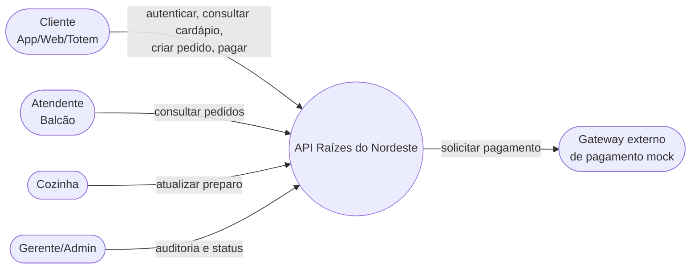
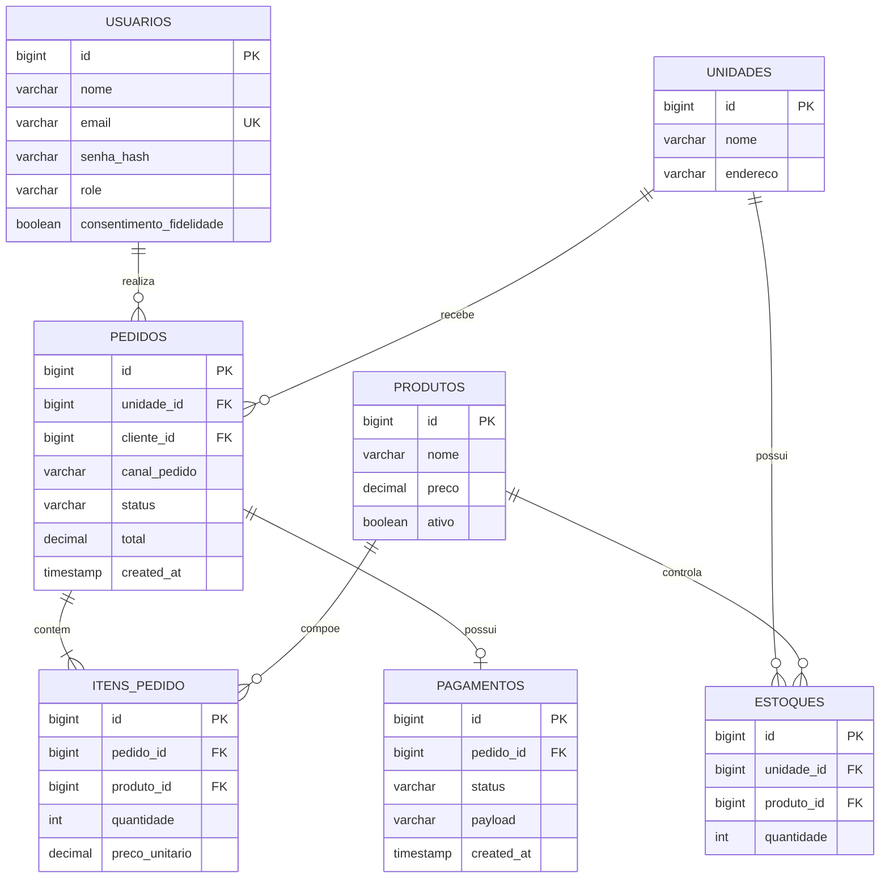
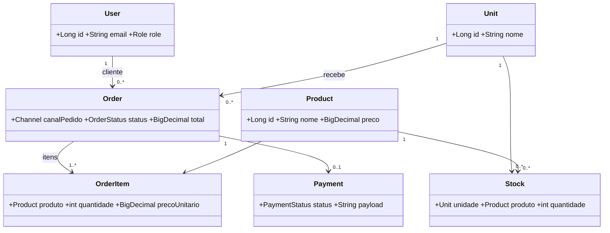
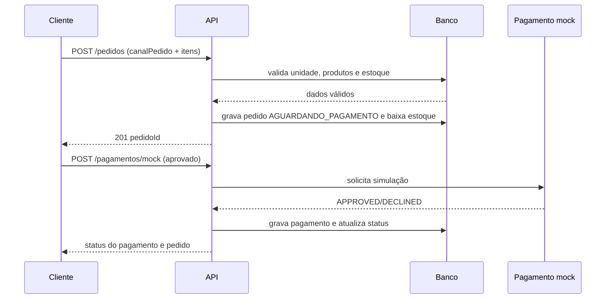
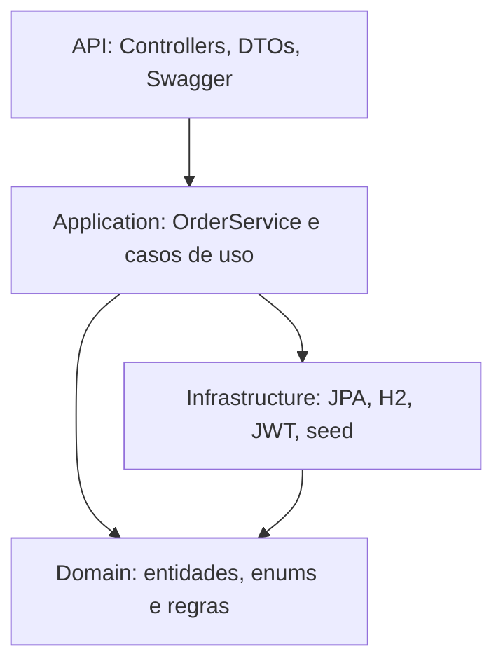

# Diagramas da solução

Os diagramas abaixo estão em Mermaid para permanecerem versionáveis e reproduzíveis. Podem
ser renderizados no GitHub, no VS Code com uma extensão Mermaid ou no Mermaid Live.

## Casos de uso

## DER

## Classes de domínio

## Sequência do fluxo crítico

## Arquitetura em camadas

